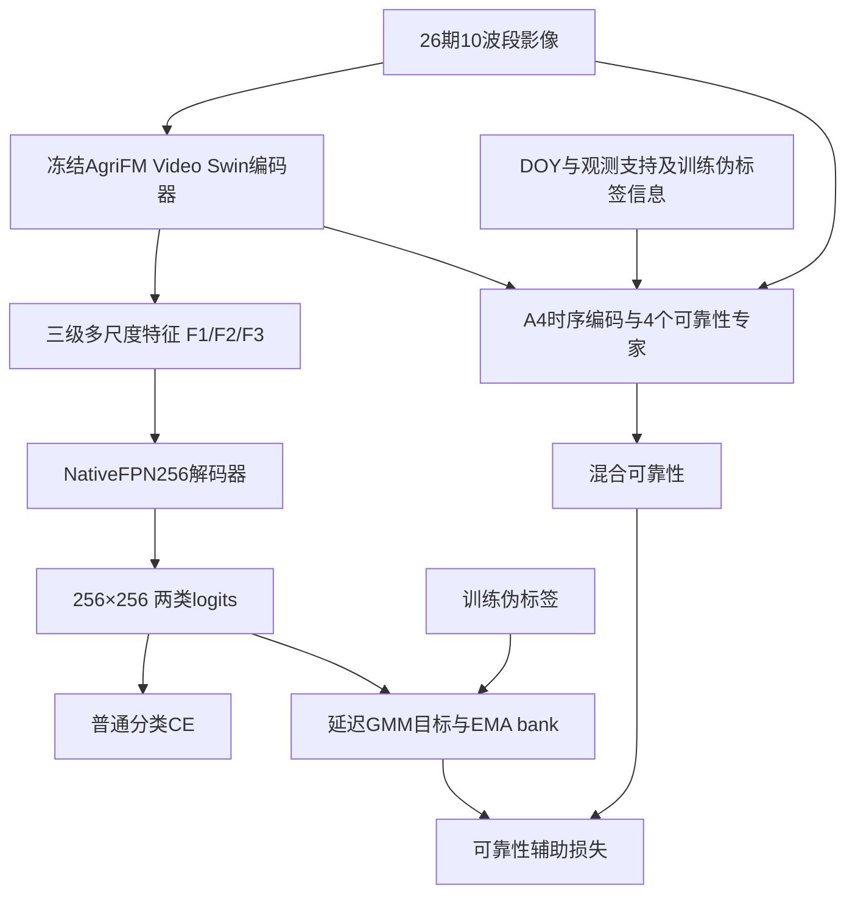

# B1模型架构

## 输入与归一化

原影像为[B,26,10,256,256]，分别生成AgriFM发布统计归一化输入和Train1296统计归一化的A4输入。source_map生成[B,16,1024,26]真实观测比例，DOY为[B,26]。输入不能提前乘10000或重复归一化。

## 分类路径

图中没有从可靠性回到分类logits的箭头，这与本B1配置一致。GTdev和最终测试只需要分类路径，专家辅助监督是训练过程的一部分。

AgriFM使用静态3D patch embed，patch_size=(4,2,2)、embed_dim128，Video Swin depths=[2,2,18,2]、num_heads=[4,8,16,32]、window_size=(8,7,7)，输入时间长度先按原实现补至28。发布的patch权重按原加载器做空间核调整。

编码器输出F1/F2/F3的接口为[B,1024,64,64]、[B,1024,32,32]、[B,1024,16,16]。F1的1024是256通道与4时间组展平，解包顺序必须先[B,256,4,H,W]再转为[B,4,256,H,W]。

NativeFPN256分别用1×1卷积+GroupNorm+GELU把三个特征映射到128通道，再逐级双线性上采样相加，经过两个3×3卷积块，恢复256×256，最后1×1卷积输出2类logits。名称中的256表示输出空间分辨率，FPN内部宽度是128。

## 可靠性专家

A4把影像分成4×4个64像元窗口；每个窗口含32×32个2×2 patch，每个patch有26个时间token、token维度128。时间Transformer、DOY及support编码之后，progress标量和有序中心产生K4软路由，结合WPE和冻结AgriFM上下文，交给专家与importance gate。

标量专家预测的是训练伪标签可靠性，聚合为[B,16,1024]，对应128×128的patch网格。原代码已包含伪标签embedding和metadata。此B1没有启用双输出gather或类别偏置，也不保证四专家已经具有真实物候阶段语义。

代码保留feature_experts、残差适配器、多尺度输入和FiLM类以匹配原checkpoint结构；B1配置并不启用这些分类融合路径。

## 训练与测试

A3仅训练decoder，使用普通CE；M3/J3训练decoder及可靠性分支，普通CE加原可靠性辅助损失。GMM/EMA目标仅来自Train1296，分类器预测用于延迟目标刷新。J阶段名称不代表本配置开启残差。

测试时classification logits经过softmax得到玉米概率；GTdev按原85×85聚合和阈值0.5评分，CDL按冻结Native30m重投影和全局去重评分。单瓦片predict输出原10m网格概率，不能把它当成Native30m最终指标。

## 实现文件

| 文件 | 作用 |
|---|---|
| 根目录model.py | 对外架构导出入口 |
| 包内agrifm.py | AgriFM装载、冻结encoder、NativeFPN |
| 包内model.py | 总模型、阶段冻结、前向路径 |
| 包内reliability.py | 时序路由、WPE、可靠性专家与门控 |
| 包内targets.py | GMM/rank目标与EMA |
| 包内objective.py | CE和辅助损失 |
| 包内train.py | 原始9轮训练与选模 |
| 包内evaluate_native30.py | 原始CDL最终评估 |
| scripts/evaluate.py | 统一测试与预测包装，不改原评估算法 |
