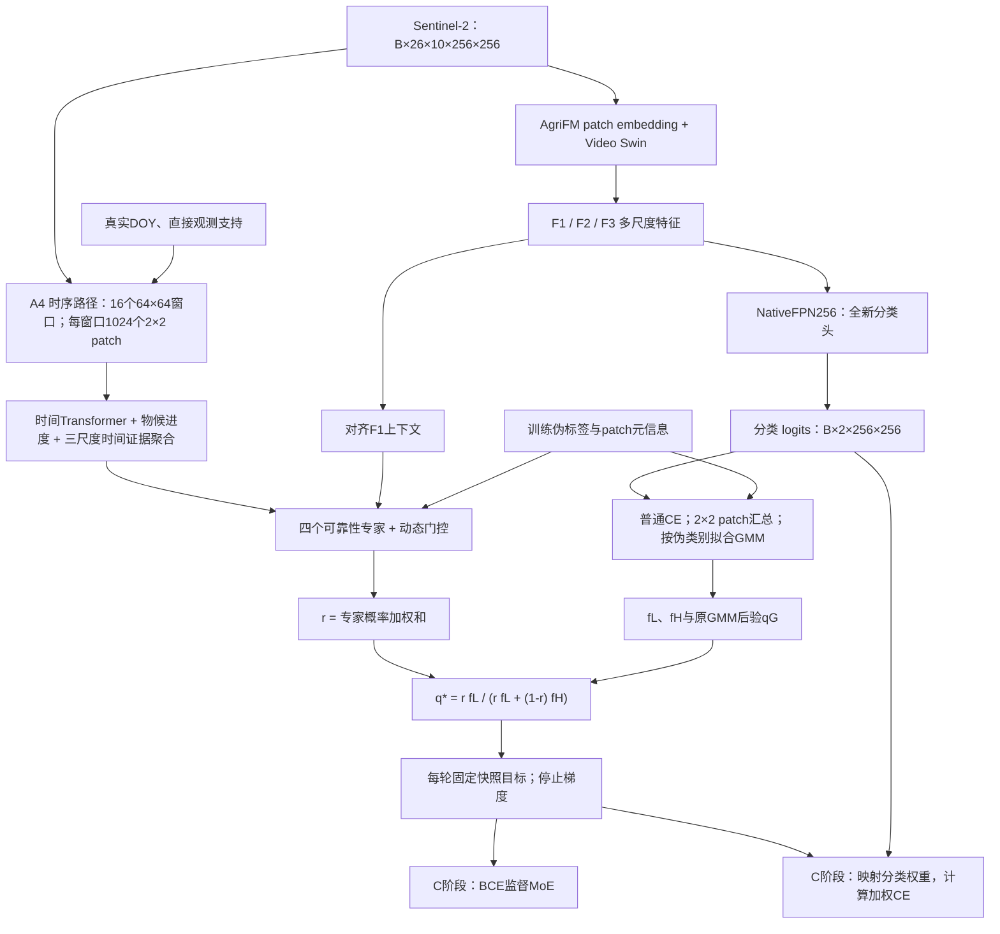

# 模型架构、损失与梯度路径

本说明对应 `code/source_manifest.json` 的 fresh-ft-v3 执行快照。当前入口为 `code/train.py`，不运行 `source_snapshot/train.py` 的历史训练 main。

## 1. 初始化边界

`common.make_model()` 创建 `FreshAgriFMA4USA`。`source_snapshot/agrifm.py` 先将原始 `AgriFM.pth` 加载到 patch embedding 与 Video Swin 编码器，再创建 NativeFPN256；随后构造 MoE、专家和门控。任务模块重新初始化，不加载任何旧下游整模型检查点。

预训练加载参数覆盖率至少90%，逐项适配与缺失情况写入 `initialization.json`。原始空间卷积核 `(4,4,4)` 按现有适配器重采样为 `(4,2,2)`；因此“从原始权重初始化”包含明确的结构适配，不声称所有张量逐字相同。物候中心保留架构规定的有序初始位置。

原始预训练文件 SHA256：

```text
3a8f4b43f466933c5607916c48f8cf9f17230f449f09e4efb7790ece3278d6a8
```

A/M 阶段之间会加载**本次运行内**达到最少轮数后的 GTdev 最佳整模型；这是本轮阶段交接，不是从历史 B1 实验续训。

## 2. 整体数据流



刷新使用同一模型快照、eval 与 inference_mode；整轮缓存目标固定，下一轮重算。推理只运行 AgriFM + NativeFPN，不需要伪标签、GMM 或 MoE。

## 3. 模块与空间对齐

|模块|输入/输出与作用|
|---|---|
|AgriFM|输入26期10波段；时间维补零到28期。静态3D patch embedding，patch `(4,2,2)`；Swin深度 `[2,2,18,2]`。|
|NativeFPN256|融合编码器三级尺度，恢复256×256二分类 logits。F1为 `[B,1024,64,64]`。|
|可靠性时序支路|16个64×64窗口，各1024个2×2空间patch；每patch处理26期40维光谱向量，时序特征维128。|
|物候与时间证据|学习进度 `phi`、有序中心与软阶段路由；按真实DOY使用14/42/90天时间核聚合直接观测证据，并门控注入。|
|F1上下文|F1还原四个时间组，对齐到2×2 patch网格；各专家对四组上下文做注意力。|
|可靠性专家|四个标量专家接收阶段特征、F1上下文、伪类别嵌入和观测/标签元信息；门控输出四个归一化权重。|
|可靠性网格|`[B,16,1024]` 转为 `[B,128,128]`，与2×2 patch损失对齐；分类权重用最近邻还原256×256。|

可靠性输出是概率混合：

$$r_i=\sum_{k=1}^{4}\alpha_{ik}\,\sigma(h_k(\cdot)),\qquad \alpha_i=\operatorname{softmax}(g(\cdot)).$$

没有使用专家 logits 平均替代概率混合。未启用的特征专家残差等兼容模块不参与本版分类融合。

## 4. GMM与联合后验

普通像元CE先在2×2 patch内按有效像元平均。至少3个有效像元且多数类比例≥0.75，并至少有一期直接观测，才进入可靠性证据集合。每瓦片、每伪类别分别拟合两分量GMM；q05/q95缩放到 `[0,1]` 后拟合，以较低均值分量为L。

$$q_i^G=\frac{\pi_L f_L(u_i)}{\pi_L f_L(u_i)+(1-\pi_L)f_H(u_i)},$$

$$q_i^*=\sigma\!\left(\operatorname{logit}(\operatorname{clip}(r_i))+\eta[\log f_L(u_i)-\log f_H(u_i)]\right).$$

默认 `eta=1`、`eps=1e-4`。联合后验中的PDF不包含混合比例；融合用MoE先验替换群体先验，不再额外乘一次 `pi_L`。融合在FP64对数域计算，输出FP32。

|情况|分类权重|可靠性BCE|
|---|---|---|
|合格patch且GMM成功|C阶段使用q*|M阶段学qG，C阶段学q*|
|合格patch但GMM失败|C阶段回退MoE先验r|跳过|
|未达纯度要求/不足有效标签/无直接观测patch|有效标签像元保持单位权重|跳过|
|标签255|不计入CE|不计入有效监督|

失败回退不使用rank；全局结构正则保持原定义，不随BCE掩码逐项屏蔽。低损失代表较可靠标签是建模假设。

## 5. 损失与反向传播

令 `q` 为每轮缓存的目标（M:qG，C:q*）：

$$L_{rel}=\operatorname{BCE}(\operatorname{clip}(r),\operatorname{sg}(q))+0.01L_{balance}+0.02L_{mono}+0.01L_{sep}.$$

BCE局部关闭autocast，以FP32计算；目标停止梯度。MSE只作诊断日志，不进入优化目标。均衡正则作用于平均专家门控，单调正则惩罚进度倒退，中心间距正则要求最小间隔0.15。

分类权重默认：

$$w_i=0.15+0.85\,\sigma((\operatorname{sg}(q_i^*)-0.6)/0.1),$$

$$L_{CE,w}=\frac{\sum_i w_i\ell_i}{\sum_i w_i},\quad L_{cls}=(1-\alpha)L_{CE}+\alpha L_{CE,w},\quad \alpha=\min(1,e_C/3).$$

无可靠性证据的位置按上述回退表处理。分类权重本身停止梯度。总损失：A为普通CE；M为普通CE + `lambda * Lrel`；C为渐进加权CE + `lambda * Lrel`，默认lambda=1。

|参数/路径|冻结组|全量微调组|
|---|---|---|
|编码器|所有阶段冻结/eval|所有阶段可训练/train；CE可更新；M/C可靠性损失还可经F1上下文更新|
|NativeFPN|所有阶段由分类CE训练|相同|
|MoE、时序编码、专家及门控|A不训练；M学qG；C学q*|相同|
|缓存q与分类权重|停止梯度|停止梯度|

AdamW分组：encoder=1e-5（仅fullft）、decoder=1.5e-4、reliability=1e-4，weight_decay=1e-4。各组独立clip_norm=1，A/M/C边界重建优化器。完整模型梯度检查见验收证据。
